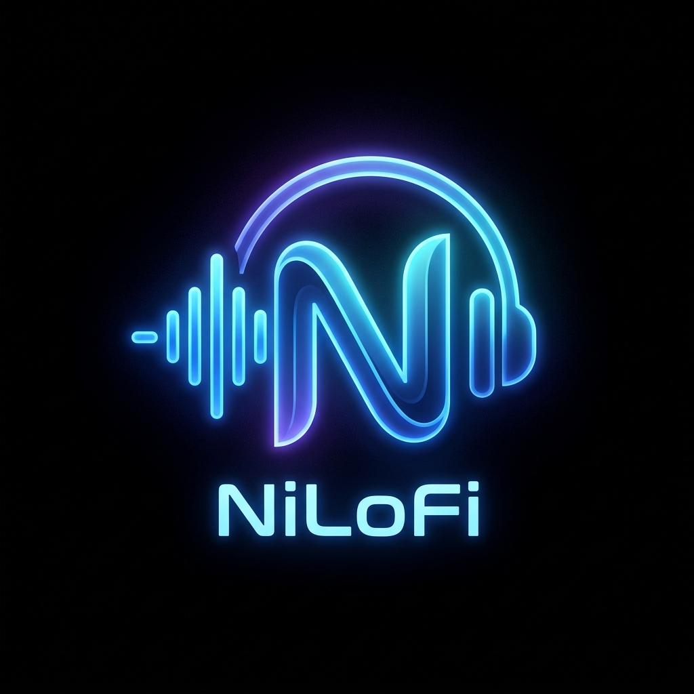

<div align="center">
  
  <h1>NiLoFi</h1>
  <p><strong>Studio-Grade Offline AI Music Player for Android</strong></p>
  <p><em>100% Free-Tier • Zero Cloud Costs • True OLED Dark Aesthetic</em></p>

  [](https://github.com/ftniloy5757/NiLoFi/actions/workflows/build-apk.yml)
  [](LICENSE)
  []()
  []()
  []()
</div>

---

> **Courtesy Notice:** © 2026 Farhan T. Niloy. All rights reserved.

---

## 🌟 What is NiLoFi?

**NiLoFi** is an enterprise-grade, offline-first local Android music player crafted to surpass legacy media players (like Poweramp, Musicolet, and Samsung Music). Built using **React Native & Expo Bare/Prebuild**, NiLoFi bridges cutting-edge on-device machine learning heuristics with Android's native hardware `AudioEffect` DSP stack.

### 💎 Key Highlights

- 🧠 **Session-Aware AI Adaptive Shuffle:** Replaces traditional pseudo-random shuffle with an on-device contextual vector engine that analyzes completion rates, early skips, and manual selections to learn your active listening vibe in real-time.
- 🎛️ **Studio 10-Band Graphic Equalizer:** Direct hardware binding to Android's `Equalizer`, `BassBoost`, `Virtualizer`, and `LoudnessEnhancer` with an **Anti-Clipping Soft Limiter** that dynamically reduces pre-amp gain to eliminate speaker crackle.
- 🏷️ **Smart Categorization & Auto-Albums:** Auto-buckets thousands of local tracks by language (Punjabi, Bollywood, Bangla, English), era (90s, 2000s, 2010s, 2020s), and mood (Rain & Lofi, Romantic, Mashups & Remixes) in milliseconds.
- 🔒 **Native Android Lock-Screen Controls:** Persistent foreground media playback with 5 notification center buttons (including a dedicated **Adaptive Shuffle Toggle**).
- 📜 **Synced LRC & Waveform Scrubber:** 40-bar interactive amplitude seekbar and glassmorphic synced lyrics with binary-search time tracking.
- 🌙 **OLED Pitch Black Aesthetic:** Deep `#000000` surface designed for zero battery waste on AMOLED screens, accented with Electric Royal Blue (`#2563EB`) and Neon Cyan (`#38BDF8`).
- 💸 **100% Free-Tier:** Zero cloud subscriptions, zero third-party API keys, and automated GitHub Actions to build installable APKs completely free.

---

## 📱 Visual Showcase & Architecture

```
NiLoFi Application Core
├── Native Hardware DSP (Kotlin Module)
│   ├── android.media.audiofx.Equalizer (10 Bands: 31Hz - 16kHz)
│   ├── android.media.audiofx.BassBoost & Virtualizer
│   └── Anti-Clipping Soft Limiter (Auto-PreAmp Gain)
├── Contextual Session Engine
│   ├── Track Vectorization (Romantic, Sad, Lofi, Energy, Acoustic, Mashup)
│   ├── Real-Time Skip Penalty (-2.5) & Completion Boost (+3.5)
│   └── Cosine Similarity Queue Re-Ranking with 15% Serendipity
├── Two-Tier Media Scanner
│   ├── Tier 1: High-Speed Native MediaStore Cursor (< 500ms)
│   └── Tier 2: Deep Tag & Synced LRC Parser
└── UI Experience (OLED 120Hz)
    ├── Library & Multi-Filter Search
    ├── Smart Auto-Albums & Custom Playlists
    ├── DSP Studio Equalizer & Output Device Profiles
    ├── Session Telemetry Radar
    └── Expandable Floating Mini-Player & Hero Now-Playing
```

---

## 🚀 How to Build & Install onto Your Phone

### Option A: Download Pre-Built APK via GitHub Actions (Recommended, No Setup Needed)
1. Push this repository to `https://github.com/ftniloy5757/NiLoFi.git`.
2. Open your repository on GitHub and click on the **Actions** tab.
3. Select the latest run of **"Build NiLoFi Android APK"**.
4. Once completed (approx. 4-5 minutes), scroll to **Artifacts** at the bottom of the page.
5. Download **`NiLoFi-Android-APK`**, unzip it, transfer `NiLoFi-v1.0.0.apk` to your phone, and tap **Install**!

---

### Option B: Local Android Build via Terminal

#### Prerequisites
- Node.js 18+ or 20+
- JDK 17
- Android Studio with Android SDK Platform 34 installed

#### Steps
```bash
# 1. Clone repository
git clone https://github.com/ftniloy5757/NiLoFi.git
cd NiLoFi

# 2. Install dependencies
npm install

# 3. Generate native Android project via Expo Prebuild
npx expo prebuild --platform android --clean

# 4. Compile and install directly to your connected Android phone (via USB Debugging)
npx expo run:android
```

---

## 🎧 Feature Walkthrough & Usage Guide

| Feature | How to Use |
|---|---|
| **Adaptive Shuffle** | Tap the **Shuffle** button on the Now Playing screen or Library. The badge will illuminate neon blue (`Adaptive ON`). The engine will immediately begin learning your mood. |
| **Reset Mood** | If your listening mood changes abruptly, tap **Reset Mood** on the Now Playing screen or Session AI tab to clear the vector weights. |
| **10-Band DSP Equalizer** | Switch to the **DSP EQ** tab. Pick from 8 scientifically calibrated curves or manually adjust sliders. Notice the **Anti-Clipping Auto-Gain** automatically protect against audio distortion. |
| **Synced Lyrics** | While a song is playing, tap **SYNCED LYRICS** at the bottom of the Now Playing screen. If a `.lrc` file exists with matching name, lyrics scroll in real-time. |
| **Sleep Timer** | Tap the **Moon** icon in the header. Choose 15m, 30m, 45m, or 60m. Over the final 30 seconds, NiLoFi smoothly ramps down the volume to zero. |
| **Lock-Screen Controls** | Lock your phone while music is playing. You will see high-resolution artwork and 5 controls including the Adaptive Shuffle toggle directly on your lock screen. |

---

## ⚖️ License & Courtesy

Distributed under the MIT License. Developed with pride by **Farhan T. Niloy**.

```
© 2026 Farhan T. Niloy. All rights reserved.
```
